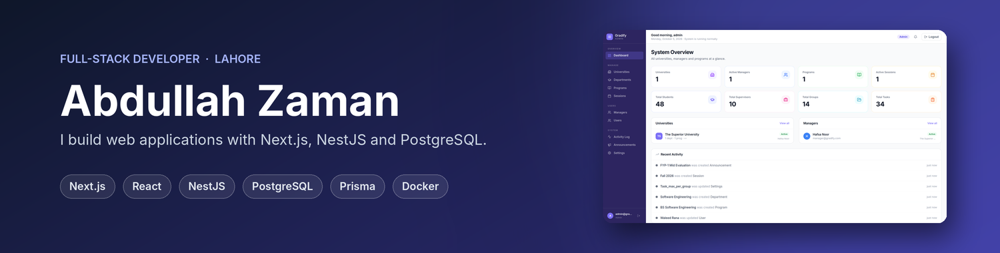

Full-stack developer in Lahore, finishing a BS in Software Engineering at The Superior University. Most of my work is in TypeScript: Next.js on the front end, NestJS on the back end, PostgreSQL with Prisma underneath. I also build in Laravel and plain PHP when a project calls for it.

### Projects

#### [Gradify](https://github.com/Abdullah-Zaman/gradify)

My final year project, built on my own. It handles the full FYP cycle for a university department: group formation and invites, supervisor preferences, proposals, weekly tasks reviewed per member, Minutes of Meeting, and reporting for managers. Some of the parts I spent the most time on: JWT auth with refresh token rotation, Excel/CSV student import that detects columns automatically, semester-aware FYP ID generation, an audit log for sensitive actions, and a weekly job that pulls each student's GitHub activity so supervisors can see real progress. I'm currently preparing it for deployment in my department.

`Next.js 16, NestJS 11, PostgreSQL, Prisma, Docker`

#### [Student Support & Grievance Portal](https://github.com/Abdullah-Zaman/student-support-portal)

A portal for the Software Engineering Department at Superior University that replaces the paper application process. Students submit and track requests, an admin officer reviews and replies, and a super admin manages categories and settings. In active development.

`Laravel, Livewire, Alpine.js, MySQL, Tailwind CSS`

#### [Journal Management System](https://github.com/Abdullah-Zaman/ojs-journal-system)

A smaller system modelled on Open Journal Systems, with Author, Reviewer and Editor roles covering submission, peer review and publishing. Written in procedural PHP with prepared statements, bcrypt password hashing and a locked-down upload folder.

`PHP, MySQL, Bootstrap 5`

### Tools I work with

### Contact

I'm open to full-time developer roles and freelance web projects. The easiest way to reach me is on [LinkedIn](https://www.linkedin.com/in/abdullah-zaman-rj/).
